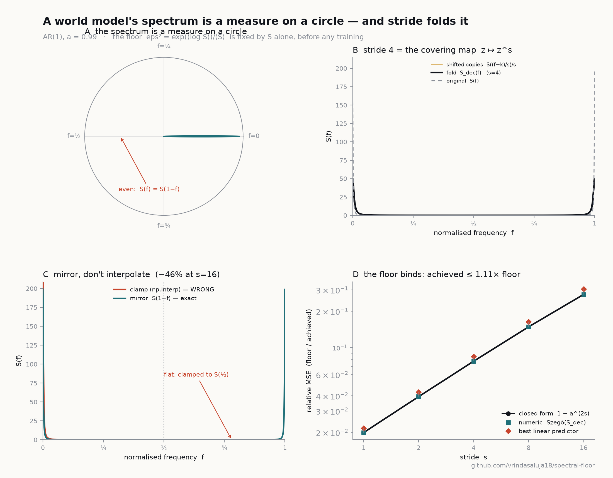

# spectral-floor

**How fast must a world model look?** A computable information-theoretic floor on the temporal
sampling rate, derived from the data's power spectrum *before any training*.



*The whole thesis in one image. **A** the spectrum is a measure on the unit circle, and it is
even, `S(f) = S(1−f)`, because the process is real. **B** decimating by stride `s` is the
covering map `z ↦ z^s`: the `s` shifted copies sum to the fold, which is the aliasing identity.
**C** the symmetry is the computation — expanding a one-sided spectrum by interpolation
*clamps* it and silently biased the floor 46% low at `s=16`; mirroring is exact. **D** the floor
`eps² = exp(⟨log S⟩)/⟨S⟩` is fixed by `S` alone, and a best-in-class predictor lands within 11%
of it at every stride. Regenerate with `python3 scripts/make_figure.py`.*

## Results

At stride `s` a world model sees `R/s` samples per second and, by Nyquist, nothing above
`R/(2s)` Hz. The table is the thesis in one shot: the theoretical floor (Kolmogorov–Szegő on the
*aliased* spectrum) against what a best-in-class linear predictor actually achieves, on an AR(1)
process with `a = 0.99` (400k samples, held-out evaluation).

| stride `s` | floor (estimated S) | floor (analytic S) | best linear predictor | gap to floor |
|---|---|---|---|---|
| 1 | 0.02019 | 0.01990 | 0.02162 | 1.09× |
| 2 | 0.04004 | 0.03940 | 0.04299 | 1.09× |
| 4 | 0.07902 | 0.07726 | 0.08430 | 1.09× |
| 8 | 0.15336 | 0.14854 | 0.16321 | 1.10× |
| 16 | 0.28972 | 0.27502 | 0.30550 | 1.11× |

**Key finding: the floor is exact for *linear* prediction, and binds tightly there.** A
best-in-class linear predictor sits within 11% of the theoretical floor at every stride, and the
gap is *constant* — it does not grow with stride. This is expected: `eps²` **is** the optimal
linear predictor's error (Kolmogorov–Szegő), so a well-fit linear predictor must approach it.

The floor is a lower bound for the *linear* class. It is **not** a lower bound for nonlinear
models: on deterministic or finite-order nonlinear processes a reservoir (a small echo-state
network) beats the floor, by up to **~30× at stride 1** (logistic map, `r = 3.9`: floor 0.634 vs
ESN 0.017). The gap closes as stride grows and aliasing destroys the recoverable structure. See
`experiments/run_nonlinear_experiment.py`.

The law exposes the trade-off, computable before training anything:

| `a` (corr. time) | s=2 | s=4 | s=8 | s=16 | state samples/s saved at s=16 |
|---|---|---|---|---|---|
| 0.90 (~10 steps) | 1.81× | 3.00× | 4.29× | 5.08× | 16× |
| 0.99 (~100 steps) | 1.98× | 3.88× | 7.46× | **13.82×** | 16× |
| 0.995 (~200 steps) | 1.99× | 3.94× | 7.73× | 14.86× | 16× |

At `a = 0.99`, stride 16 makes the best-possible *linear* error **13.8× worse** while reducing
the state sampling rate **16×**. Stride is not a vibe; it is a design choice with a predictable
accuracy cost, and that cost curve is computable up front. The last column is the sampling-rate
saving (`s`), not a bytes measurement — the package computes no bytes (see Limitations).

### Honest negative, on the first screen

The intuitive claim *"the fraction of power above the model's Nyquist frequency lower-bounds the
prediction error"* is **false**. A finite sum of sinusoids has all its power below 10 Hz, yet a
stride-2 model predicts it essentially perfectly (rel. MSE ≈ 0.000000) — because such a process
is deterministic and finite-order, so the high frequencies are *determined* by the low ones
through a linear recurrence. Aliasing only destroys information when the high-frequency content
is **independent**. The right object is not "power above Nyquist" but "power that is **not
linearly predictable**" — which is exactly what Kolmogorov–Szegő measures. See
`docs/research-plan-sampling-rate.md` §2.1 for the counterexample.

## The maths

*From basics — that is the point.* A **stationary** process is one whose statistics do not change
with time. Its **power spectral density** `S(f)` says how much variance lives at each frequency
`f`. Prediction asks: given the past, how much of the next sample is left over? For a process
with spectrum `S`, the best any *linear* predictor can do — at any order, with any amount of
data — is fixed by `S` alone. Nothing about the model matters: the floor is a property of the
process, not of the architecture.

### The floor

For a stationary process with power spectral density `S(f)`, the optimal one-step-ahead relative
MSE of **any** linear predictor — any order, any data — is

```
eps² = exp( ⟨ log S ⟩ ) / ⟨ S ⟩
```

(Kolmogorov 1941; Szegő 1920). `⟨·⟩` is the mean over the band. This is exact and classical.
For `AR(1)` with coefficient `a`, it gives `1 − a²` to 8 digits.

### Decimation

Observing at stride `s` decimates the process. The spectrum folds:

```
S_dec(v) = (1/s) Σ_{k=0}^{s-1} S( (v + k) / s )
```

The floor of a stride-`s` world model is `szego(S_dec)`.

### The closed form

For a first-order process the folding collapses to

```
eps²(s) = 1 − a^(2s)
```

verified exactly (max error 7.6e-8 over 49 `(a, s)` pairs).

### The design law

Going from stride 1 to stride `s` multiplies the irreducible error by
`(1 − a^(2s)) / (1 − a²)`. This is the second table above, in closed form.

## Open question: the other half

This project answers the *temporal* half of one question:

> **How fast must a world model look?**

The *state* half is open, and it is the one I want next:

> **How many latent dimensions must a world model keep?**

Same shape of answer: a computable bound from the environment's own properties, plus a measured
gap between the bound and what a trained model actually uses. The temporal half has an
80-year-old closed form (used here). The state half is exactly what **Takens' theorem** answers
for delay embeddings — and the obvious search phrase returns **0 arXiv hits**, so the framing is
new. The link to *"we lose dimensions in latent space and have to maintain KV caches"* is
direct: KV-cache size is the state-axis cost, the way bytes-per-second is the time-axis cost.

> *"We ask how fast a world model must look and how many dimensions it must keep, and show both
> are computable from the environment before training."*

See `docs/research-findings-2026-11-13.md` §4 (Proposal B, `latent-floor`) and
`docs/research-plan-sampling-rate.md`.

## Reproduce

```bash
pip install numpy pytest
python3 -m pytest tests/ -q                       # 76 passed
PYTHONPATH=. python3 -m experiments.run_floor_experiment --source ar1 --a 0.99
PYTHONPATH=. python3 -m experiments.run_nonlinear_experiment   # the nonlinear gap
```

Output:

```
  stride  floor(est)  floor(true)   achieved  gap(true)
  ------------------------------------------------------
       1     0.02019      0.01990    0.02162      1.09x
       2     0.04004      0.03940    0.04299      1.09x
       4     0.07902      0.07726    0.08430      1.09x
       8     0.15336      0.14854    0.16321      1.10x
      16     0.28972      0.27502    0.30550      1.11x

  max gap = 1.11x  ->  floor is TIGHT for the linear predictor (as the theorem requires)
```

The nonlinear gap, same machinery, different processes:

```
  process                     s     floor       lin  gap_lin       esn  gap_esn
  ------------------------------------------------------------------------------
  ar1(0.99) [linear]          1   0.01905   0.02319    1.22x   0.02301    1.21x
  logistic 3.9 [chaotic]      1   0.63382   0.63652    1.00x   0.01676    0.03x
  logistic+noise              1   0.71604   0.70858    0.99x   0.04702    0.07x
  nl_ar tanh                  1   0.15715   0.16079    1.02x   0.13559    0.86x
```

## The trap that is easy to fall into

**Expanding a one-sided spectrum to the full band is not interpolation.**

`welch_psd` returns the spectrum on `[0, 0.5]`. The aliasing identity folds the whole `[0, 1)`
band, so the upper half is needed. The obvious move — `np.interp(u, grid, S_hat)` with `u`
spanning `[0, 1)` — is wrong: `np.interp` **clamps** every frequency above 0.5 to `S(0.5)`,
turning the upper band into a constant. Because the folding step sums shifted copies of `S`,
that error compounds with stride. On AR(1) at `a = 0.99` it made the floor look **46% too low at
`s = 16`** (0.148 against the true 0.275) — which would have made a perfectly good model look
artificially bad.

A real-valued stationary process has an **even** density, `S(f) = S(1 − f)`, so the correct
expansion is a *mirror*, not an interpolation. `two_sided_psd` does this exactly, and the
estimator now tracks the analytic floor to within a few percent at every stride.

This is no longer a rule you have to remember: `Spectrum.from_welch` always returns the
mirrored two-sided form, and the fold routines accept only a `Spectrum`. The one-sided
estimate cannot be folded as if it were two-sided, because there is no bare array to pass.

An earlier version of this project attributed the discrepancy to Welch estimator bias. That was
wrong: the estimator was fine and the resampling was the bug. `scripts/diagnose_resampling.py`
reproduces both constructions on an exactly-known spectrum, and `docs/FINDINGS-resampling.md`
writes up the measured error at each stride.

### A second trap: an interval that looks tighter than it is

The first version of `floor` attached an analytic confidence interval,
`Var(⟨log Ŝ⟩) ≈ ψ₁(K)/M`. Measured against the AR(1) oracle it was **~165× too narrow**,
because Welch frequency bins are correlated — the window's leakage kernel couples
neighbours — so treating `nperseg/2` bins as independent is simply wrong. The interval is now
a percentile bootstrap over the segments, which carries that correlation through the fold.
A residual bias remains at large stride (the Welch window smooths the spectrum); the cure is
resolution (`nperseg`), and `docs/SYSTEM-DESIGN.md` §5 states it plainly.

## What is in here

```
spectral_floor/
  psd.py       Welch periodogram, one-sided -> two-sided expansion, analytic AR(1) PSD
  spectrum.py  the Spectrum type: parse an estimate, don't validate it
  floor.py     Kolmogorov-Szego, the aliasing identity, the design law, FloorResult
experiments/
  run_floor_experiment.py   the Week-1/Week-2 go/no-go: floor vs achieved error
tests/       73 tests, all passing, checked against oracles
docs/        the maths, the explainer, the reading list, the strategy
  figures/spectral-floor.png   the one-image thesis (regenerate: scripts/make_figure.py)
scripts/     diagnostics + the figure generator
```

### The API: parse, don't validate

The floor routines take a **`Spectrum`**, never a bare array. A `Spectrum` carries
its grid, its sidedness, its normalisation and its number of segments, so a
one-sided estimate cannot be silently folded as if it were two-sided — the bug
class behind the clamp. `Spectrum.from_welch(x)` always returns the two-sided form
the folding step needs. `floor` returns a `FloorResult`, not a float:

```python
from spectral_floor import Spectrum, floor, design_law, optimal_stride

S = Spectrum.from_welch(x, nperseg=1024)      # always two-sided
r = floor(S, stride=4)                        # FloorResult
print(r.eps2, r.ci_low, r.ci_high, r.warnings)
print(design_law(S, [1, 2, 4, 8, 16]))        # inflation vs stride 1, no AR(1) needed
print(optimal_stride(S, max_inflation=2.0))   # the largest affordable stride
```

See `docs/api.md` for the full surface and `docs/SYSTEM-DESIGN.md` for the
architecture and the invariants at each boundary.

### What is in `docs/`

| File | What it is |
|---|---|
| `SYSTEM-DESIGN.md` | The architecture: layers, data flow, invariants, why a bootstrap |
| `api.md` | The full API surface, with a worked example |
| `research-plan-sampling-rate.md` | The research plan: is this paper-shaped, and where is the gap? |
| `reading-list-option-a.md` | Annotated reading list for the programme. |
| `strategy-project-or-pr.md` | Decision doc: project vs PR, and where. |
| `FINDINGS-resampling.md` | The one-sided-spectrum clamping bug: measured error, fix, tests. |
| `research-findings-2026-11-13.md` | What is open in the field, and where to work next. |
| `aliasing_floor_demo.py` | Runnable demo: aliasing, the fold, and the floor. |
| `decoder-explained.md` / `.html` | Companion notes for the animated decoder explainer. |
| `diffusion-maths-and-signals.md` | The diffusion-decoder maths, signals-first. |
| `verify_decoder_maths.py` | Numeric checks for the decoder notes. |

## Status and roadmap

- [x] The floor formula, verified against AR(1) theory
- [x] The aliasing identity, verified (power preservation, periodic fold)
- [x] The closed form `eps²(s) = 1 − a^(2s)`, verified exactly
- [x] Experiment runner: floor vs achieved error, with the aliasing gap
- [x] Typed `Spectrum` API (parse, don't validate) and a `FloorResult` with interval + warnings
- [x] Decision layer on a *measured* spectrum (`design_law`, `optimal_stride`)
- [x] Bootstrap confidence intervals; 73 tests checked against oracles
- [ ] **Week 1:** estimate `S` from a *real* environment (Atari / DMControl). Does the floor
      still bind with a measured spectrum?
- [ ] **Week 2:** train a small world model at two strides. Measure the gap. **Go/no-go.**
- [ ] **Week 3+:** 3 environments, paired tests, interval estimates, write-up

## Limitations (stated honestly)

- **The floor is the floor for *linear* prediction only.** `eps² = exp(⟨log S⟩)/⟨S⟩` is the exact
  optimal one-step error of the best *linear* predictor (verified against a brute-force
  Yule-Walker solve). It is a theorem that a linear predictor reaches it, so the constant ~1.1×
  gap on AR(1) is close to a tautology. Nonlinear models **beat** it: a 150-unit echo-state
  network reaches **~0.03× the floor** at stride 1 on the logistic map (`r = 3.9`), ~0.07× on a
  noisy logistic map, ~0.86–0.91× on a bounded nonlinear AR. The gap closes toward 1.0 by stride
  8 as aliasing destroys the recoverable structure. So the floor is a **lower bound for the
  linear class**, and the contribution is to *measure the gap* between it and a nonlinear model
  — not to claim the floor is unbeatable. Reproduce with
  `experiments/run_nonlinear_experiment.py`.
- **No bytes.** The package computes no byte quantities. The "16×" in the table above is the
  sampling-rate ratio `s`, not a measured byte saving. A bytes/second axis would require an
  explicit state width and sample rate, which the package does not model.
- The closed form is exact only for first-order dynamics; real environments need the numeric
  Szegő value from a measured spectrum.
- At large stride the Welch window smooths the spectrum and the estimated floor drifts high
  (about +15% at `s=16` with `nperseg=256`, falling to +0.04% at `nperseg=4096`). The bootstrap
  interval widens but cannot move a biased centre, so at coarse resolution the interval does not
  cover the analytic value. The cure is resolution, not a wider interval.
- Everything so far is simulated. The real test is Week 1.

## Positioning

> Prior work treats temporal resolution as a hyperparameter to be tuned. We show it has a
> computable information-theoretic floor, and use it to choose the resolution.

## References

| Work | Role |
|---|---|
| Kolmogorov (1941); Szegő (1920) | the floor formula |
| Brockwell & Davis, *Time Series*, Ch. 5 | readable source for the floor |
| Oppenheim & Schafer, *DTSP*, Ch. 10 | multirate / the aliasing identity |
| Percival & Walden (1993) | honest PSD estimation |
| Hafner et al., DreamerV3 — arXiv:2301.04104 | the world model |
| Hansen et al., TD-MPC2 — arXiv:2310.16828 | second world model |
| **Nhu et al., TAWM — arXiv:2506.08441** | **closest prior work** |
| Rahaman et al. — arXiv:1806.08734 | why the floor may be loose (spectral bias) |

Full annotated reading list: `docs/reading-list-option-a.md`.

## Contact

vrinda · salujavrinda018@gmail.com · [LinkedIn](https://www.linkedin.com/in/vrinda-saluja-rl) · [github.com/vrindasaluja18](https://github.com/vrindasaluja18)

## Licence

MIT.
